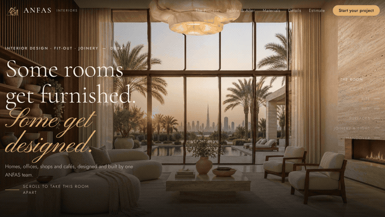
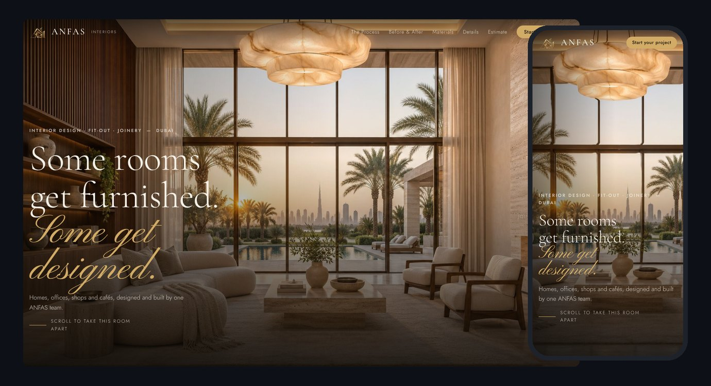

<div align="center">
  
  <h1>ANFAS Interiors</h1>
  <p><b>A scroll-driven interior design website: one room is taken apart and rebuilt, stage by stage, in 3D depth.</b></p>
  <p>
    <a href="https://dariush-tech.github.io/anfas-interiors/"><b>Live demo</b></a> ·
    <a href="#how-the-depth-reveal-works">How it works</a> ·
    <a href="#run-locally">Run locally</a>
  </p>
  <p>
    
    
    
    
    
  </p>
  
</div>

## Overview

Built for **ANFAS Mutanasiqa Decoration L.L.C**, an interior design and fit-out company in Dubai.
The page tells the story of a project through a single living room:
**concept sketch → bare shell → MEP → surfaces → joinery & light → handover**.
Everything runs from one static HTML file, with no framework and no build step.



## Features

- **WebGL depth reveal.** Each stage replaces the last from the back of the room toward the camera, following a depth map, with a gold seam along the reveal line.
- **Depth parallax.** The image shifts in depth with the mouse and with scroll.
- **Before / after slider.** A keyboard-accessible range input driving a `clip-path` mask.
- **Material studio.** The same room in five palettes (travertine & walnut, marble & brass, oak & linen, charcoal & cognac, evening light).
- **Material hotspots.** Seven points on the room, mirrored as a button list for keyboard and screen-reader users.
- **Fit-out estimator.** Budget range, time on site and cost breakdown by space type, area and finish level.
- **Resilient by default.** Falls back to plain image crossfades when WebGL or textures are unavailable, honours `prefers-reduced-motion`, and has dedicated phone layouts.

## How the depth reveal works

1. A depth map of the hero room (`img/room-depth.png`, near = white) was estimated with **Depth Anything V2**.
2. Scroll progress selects the two stages to blend and drives a depth threshold.
3. The fragment shader shows the next stage wherever the noise-perturbed depth is below the threshold, so the reveal sweeps from the far wall to the foreground:

```glsl
float k  = d + (n(q * vec2(10., 7.)) - .5) * .10;     // depth + soft noise
float th = mix(-.12, 1.15, uMix);                     // threshold driven by scroll
float m  = 1. - smoothstep(th - .05, th + .02, k);    // 1 = next stage
vec3  c  = mix(a, b, m);
float e  = 1. - smoothstep(0., .03, abs(k - th));     // seam along the threshold
c += e * vec3(1., .80, .47) * .6 * uEdge;             // gold glow
```

The same depth map drives the parallax: texture coordinates are offset by `uOff * (depth - 0.45)`, so near objects move more than far ones.

## Project structure

```
anfas-interiors/
├── index.html          # markup, styles and scripts (single file, no build step)
├── img/
│   ├── room-*.jpg      # the build stages and the four material palettes
│   ├── room-depth.png  # depth map for the reveal and the parallax
│   ├── work-*.jpg      # gallery
│   └── emblem.png, lockup.png
└── docs/               # README media
```

## Run locally

```bash
git clone https://github.com/dariush-tech/anfas-interiors.git
cd anfas-interiors
python3 -m http.server 8000
# open http://localhost:8000
```

Serve it over HTTP rather than opening the file directly: browsers block WebGL textures loaded from `file://`, and the page then falls back to plain crossfades.

## Notes

- Images are AI-generated concept visualisations, not photographs of completed projects.
- Estimator rates are indicative placeholders (AED per sq ft), kept in the `RATES` object in `index.html`.

## Credits

Client: ANFAS Mutanasiqa Decoration L.L.C, Dubai · Design & development: [Dariush Technology](https://github.com/dariush-tech)

Brand assets © ANFAS Mutanasiqa Decoration L.L.C. All rights reserved.
